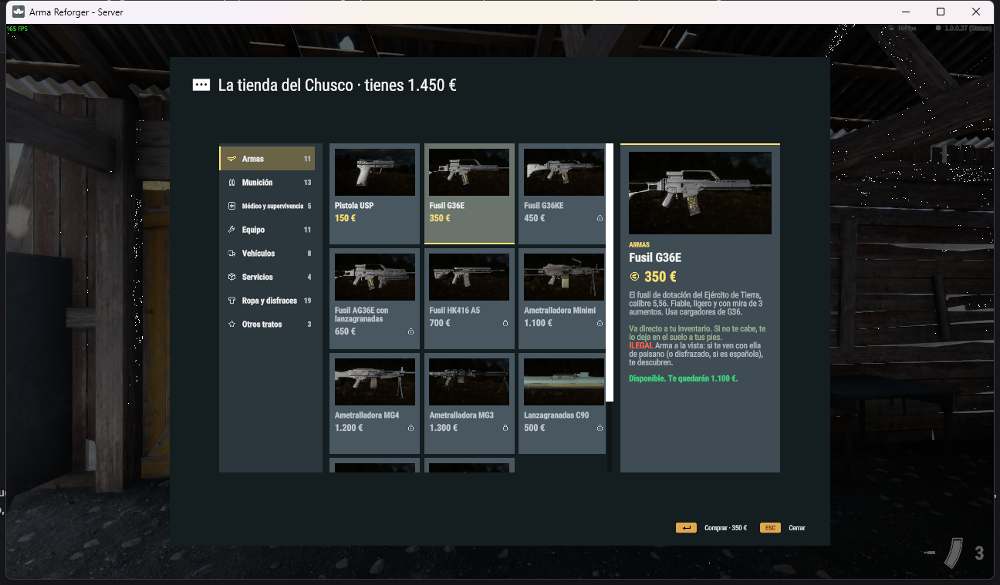

# MCES · Modern Common Economy & Shop

Tienda configurable para misiones de **Arma Reforger**. Tú pones el catálogo y tu economía; MCES pone:
- **La ventana:** pestañas por categoría, tarjetas con vista 3D del objeto y ficha con precio, descripción y estado.
- **La red:** la petición de compra va al servidor y la respuesta vuelve solo a ese jugador.

| | |
|---|---|
| GUID del mod | `AE9A7FAB88A56E07` |
| Prefijo | `MCES_` |
| Depende de | Arma Reforger (`58D0FB3206B6F859`), [MCUIK](https://github.com/victoryil/MCUIK) (`B8DFCB8639E9DA37`) |



## Cómo encaja

```
  CLIENTE                                         SERVIDOR
  MCES_Shop.Open("armeria", vendedor)
   └ ventana: catálogo ← proveedor.GetCatalog()
              saldo    ← proveedor.GetBalance()
  [Comprar] → proveedor.RequestBuy() ──red MCES──→ proveedor.Buy(jugador, artículo)
                                                   (cobra y entrega)
  proveedor.OnResult(ok, mensaje) ←──────────────── respuesta solo a ese jugador
```

El **proveedor** (`MCES_ShopProvider`) es la única pieza que escribes: conecta la tienda con tu dinero, tus reglas y tu forma de entregar.

## Páginas

| Página | Para qué |
|---|---|
| [Empezar](empezar.md) | Tienda funcionando con un `.conf` y un proveedor mínimo. |
| [Catálogo](catalogo.md) | Categorías, artículos, bloqueos, acciones extra; por `.conf` o por script. |
| [Proveedor](proveedor.md) | Cada método, dónde corre (cliente o servidor) y ejemplos completos de compra y entrega. |
| [La ventana](ventana.md) | Cómo se ve, nombres de widgets, cómo cambiar tamaños y colores. |
| [Guía para IA](guia-ia.md) | Receta y reglas para que un asistente monte una tienda sin errores. |
| [Referencia de la API](api.md) | Clases y métodos públicos (generado del código). |
