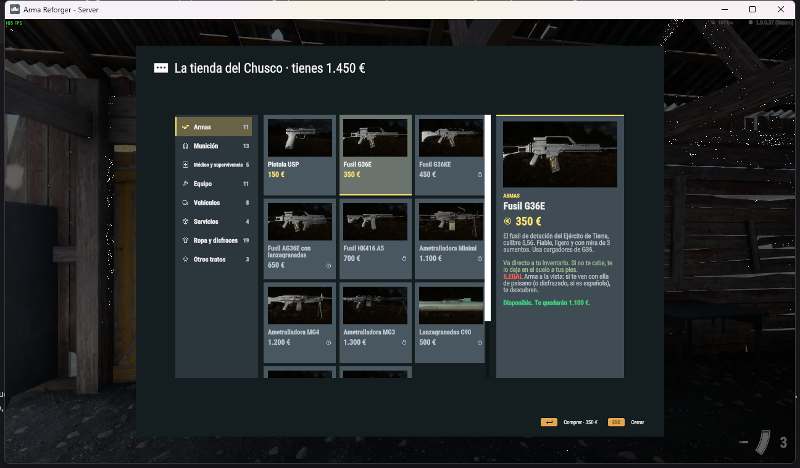

# La ventana (`MCES_ShopDialog`)

- **Preset:** `mces_shop` en `MCES_Res.C_DIALOGS`. Usa el marco grande del juego con los botones **Comprar** (confirmar) y **Cerrar**.
- **Contenido:** 1090×640.



| Zona | Widgets | Comportamiento |
|---|---|---|
| Pestañas (izquierda, 200 px) | `Tabs` → una `MCES_Tab` por categoría: `Icon`, `Label`, `Count`, `Bg`, `Strip` | La activa se marca en amarillo. |
| Tarjetas (centro) | `Grid` → filas de 3 `MCES_Card`: `Preview` (vista 3D), `Icon` (si no hay prefab), `Name`, `Price`, `Lock`, `Bg`, `Strip` | La seleccionada se resalta. Precio en rojo si no llega y en gris si está bloqueada. |
| Ficha (derecha, 310 px) | `BigPreview`, `BigIcon`, `DCat`, `DName`, `DPrice`, `DDesc`, `DState` | Estado: «Disponible. Te quedarán X», «No te llega: faltan X» o «Bloqueado: motivo». |

## Comportamiento

- Al abrir se selecciona la primera categoría y su primera tarjeta, así que la ficha nunca sale vacía.
- **Comprar** no cierra la ventana: pide la compra, desactiva el botón y vuelve a pintar a los 0,9 s. También se repinta al llegar la respuesta del servidor (`MCES_ShopDialog.RefreshOpen()`).
- La vista 3D usa el `ItemPreviewManagerEntity` del juego, la misma del inventario.

## Cambiar el aspecto

Los layouts los genera `tools/build.py`, que usa el generador de MCUIK. Para cambiar tamaños (ancho de pestañas o de ficha, tamaño de tarjeta), colores o fuentes, edita `build.py` y ejecuta:

```
python tools/build.py
```

Luego abre el proyecto en Workbench una vez para registrar los cambios. El número de columnas está en `MCES_ShopDialog.COLS`.

## Para pruebas automáticas

| Llamada | Devuelve o hace |
|---|---|
| `MCES_ShopDialog.LastTabCount()` | Pestañas creadas en la última apertura. |
| `MCES_ShopDialog.LastCardCount()` | Tarjetas de la categoría mostrada. |
| `MCES_ShopDialog.GetOpen()` | La ventana abierta (o `null`). |
| `dlg.Select("id")` | Selecciona un artículo (cambia de pestaña si hace falta). |
